# Strata Graphics

**Serveur d'habillage broadcast temps réel.** Strata dessine les habillages d'antenne (synthés, bandeaux, scores, classements, murs de messages…) à partir de modèles conçus dans le navigateur, les alimente avec des données en direct et les envoie vers les sorties du studio : HTML5, NDI, flux SRT / RTMP / HLS, SDI (DeckLink) et SMPTE ST 2110-20 fill + key.

Un seul exécutable par plateforme, un moteur de rendu en Rust, une interface web pour le designer, l'opérateur et le modérateur.

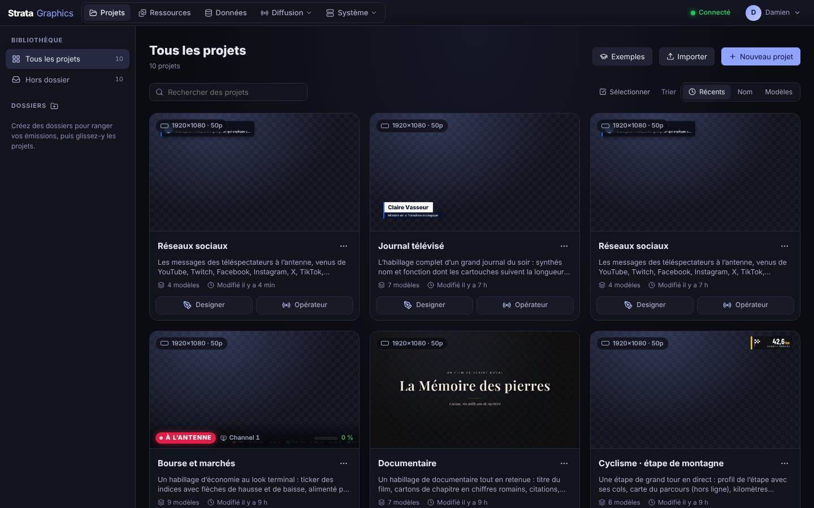

## Sommaire

1. [Vue d'ensemble](#1-vue-densemble)
2. [Installation](#2-installation)
3. [Premiers pas](#3-premiers-pas)
4. [Projets et ressources](#4-projets-et-ressources)
5. [Designer](#5-designer)
6. [Opérateur](#6-opérateur)
7. [Données](#7-données)
8. [Réseaux sociaux](#8-réseaux-sociaux)
9. [Diffusion](#9-diffusion)
10. [Système](#10-système)
11. [Intégrations et API](#11-intégrations-et-api)
12. [Développement](#12-développement)
13. [Documentation complémentaire](#13-documentation-complémentaire)

---

## 1. Vue d'ensemble

### 1.1 La chaîne de production

```
 Designer ──► modèles publiés ──► Opérateur ──► chaîne ──► sorties (HTML5 · NDI · Stream · SDI · ST 2110)
    ▲                                 ▲
    │ Data canvas                     │ conducteur, TAKE / CONTINUE / OUT, API, MOS, surfaces de contrôle
    │                                 │
 Données (sources partagées, sources du projet, modération des réseaux sociaux)
```

- Le **Designer** compose les modèles : calques, widgets, animation sur une timeline, logique entre valeurs, câblage des données.
- L'**Opérateur** joue les modèles publiés sur une chaîne : conducteur, zones d'écran, take, continue, out, mise à jour à chaud.
- Les **Données** alimentent les modèles : API JSON, CSV, Google Sheets, RSS, XML, valeurs poussées par l'automation, et les messages validés des réseaux sociaux.
- La **Diffusion** règle les chaînes, leurs formats et leurs destinations, ainsi que les entrées vidéo en direct.
- Le **Système** surveille la machine, journalise l'antenne et gère les comptes.

### 1.2 Les pages

| Menu | Page | Rôle |
| --- | --- | --- |
| **Projets** | accueil | les émissions, leurs dossiers, les exemples, l'import et l'export |
| **Ressources** | médias partagés | images, vidéos, sons et polices communs à tous les projets |
| **Données** | sources partagées | connecteurs de données et connexions aux réseaux sociaux |
| **Diffusion** | Flux vidéo · Matériel · MOS | chaînes, formats, destinations, entrées ; cartes SDI, ST 2110, synchro ; rédaction |
| **Système** | Performances · Journal d'antenne · Utilisateurs · API · Paramètres | supervision, as-run, comptes et droits, clés d'API, réglages du serveur |

Un projet s'ouvre dans son propre onglet du navigateur et a ses pages : **Designer**, **Opérateur**, **Social**, **Données**, **Ressources** et **Paramètres**.

### 1.3 Les rôles

| Rôle | Peut |
| --- | --- |
| **Admin** | tout : utilisateurs, chaînes, réglages du serveur |
| **Designer** | créer et modifier les projets et les modèles, modérer, opérer |
| **Operator** | charger un projet sur une chaîne, jouer les habillages, modérer, modifier le conducteur et ses données |
| **Viewer** | consulter les projets et les moniteurs programme |

L'interface est en **français ou en anglais**, au choix de chaque utilisateur (sélecteur à côté de son nom). Ce qui passe à l'antenne ne dépend pas de la langue de l'interface.

---

## 2. Installation

Le serveur est **un exécutable autonome** par plateforme : il embarque l'interface web, les polices et le moteur. Il s'installe en service natif.

| Plateforme | Paquet | Service |
| --- | --- | --- |
| **Windows** | installateur `.msi` avec l'app Strata Graphics (zone de notification) ; déploiement silencieux `msiexec /qn` | service Windows |
| **macOS** | installateur `.pkg` universel (Apple Silicon + Intel) avec l'app Strata Graphics (barre des menus), livré en image disque | launchd |
| **Linux** | archive avec binaire statique et `sudo ./install.sh` | systemd |

Les commandes de service sont les mêmes partout :

```bash
strata-server service install | uninstall | start | stop | status
```

Les **mises à jour** se font sans désinstaller, depuis **Système › Paramètres › Mises à jour** : en ligne (releases GitHub) ou en déposant l'archive de la version pour un serveur hors ligne, avec retour automatique à la version précédente si la nouvelle ne démarre pas.

ffmpeg est nécessaire aux sorties Stream, aux entrées vidéo (sauf NDI) et à la conversion des vidéos : les installateurs l'embarquent. Le runtime NDI est livré avec les installateurs macOS et Windows ; sous Linux, installez-le ou indiquez son chemin.

Guide complet, dossiers de données, pare-feu, proxy : [`docs/INSTALL.md`](docs/INSTALL.md).

---

## 3. Premiers pas

1. Ouvrez `http://<serveur>:8080`. Sur le serveur lui-même, la page propose de **créer le compte administrateur** ; à distance, utilisez `strata-server user add admin`.
2. Une chaîne de sortie **`main`** (1080p50) et un **projet de démonstration** sont créés. La sortie HTML5 de la chaîne est sur `http://<serveur>:8080/output/main`.
3. Dans **Projets › Exemples**, créez un projet à partir d'un des **21 exemples** : journal télévisé, info continue, football, soirée électorale, météo, bourse, talk-show, e-sport, grand prix, tennis, podcast, festival, documentaire, keynote, cérémonie, jeu télévisé, basket, cyclisme, matinale, live shopping, réseaux sociaux. Chacun est complet : modèles, conducteur, sources de données.
4. Ouvrez le projet dans le **Designer** pour voir comment il est fait, puis dans l'**Opérateur** pour le jouer sur la chaîne.

---

## 4. Projets et ressources

### 4.1 Projets

Un **projet** correspond à une émission : ses modèles, ses zones d'écran, son conducteur, ses sources de données et ses médias.

- **Cartes** : nom, description, format d'origine, nombre de modèles, aperçu du premier modèle, chaînes qui le jouent (badge *À l'antenne*), accès direct au Designer et à l'Opérateur. Un projet s'ouvre dans un nouvel onglet.
- **Dossiers** : colonne de gauche (créer, renommer, supprimer) ; glisser une carte sur un dossier. Recherche, tri par date, nom ou nombre de modèles.
- **Actions groupées** : *Sélectionner* (ou la case d'une carte, `Maj`+clic, `Ctrl+A`) puis supprimer, déplacer dans un dossier ou en créer un.
- **Créer, dupliquer, importer, exporter** (`.strata.json`), **Exemples**, et le menu *…* de chaque carte.
- **Paramètres du projet** : nom, description, format d'origine, langue des textes à l'antenne.

Toutes les pages d'un projet se mettent à jour en temps réel pour tous les utilisateurs.

### 4.2 Ressources

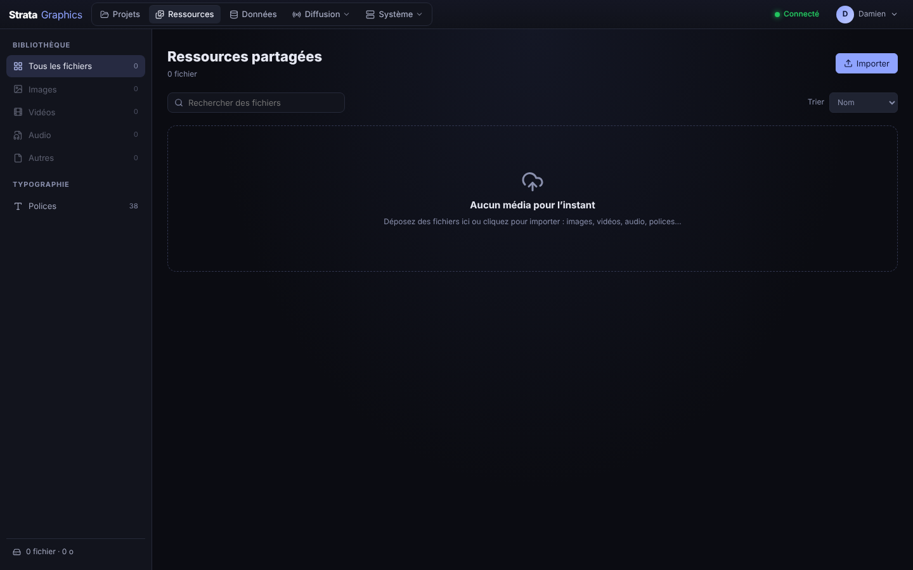

Deux bibliothèques : les **ressources partagées** (menu *Ressources*, `/assets/<fichier>`) et les **ressources du projet** (`/assets/projects/<id>/<fichier>`). Images, vidéos, sons et **polices** (communes à tous les projets) s'importent par le bouton *Importer* ou par glisser-déposer, jusqu'à 2 Go par fichier. Filtre par type, recherche, tri, copie de l'adresse, téléchargement, suppression. Le sélecteur d'image du Designer propose les deux bibliothèques.

---

## 5. Designer

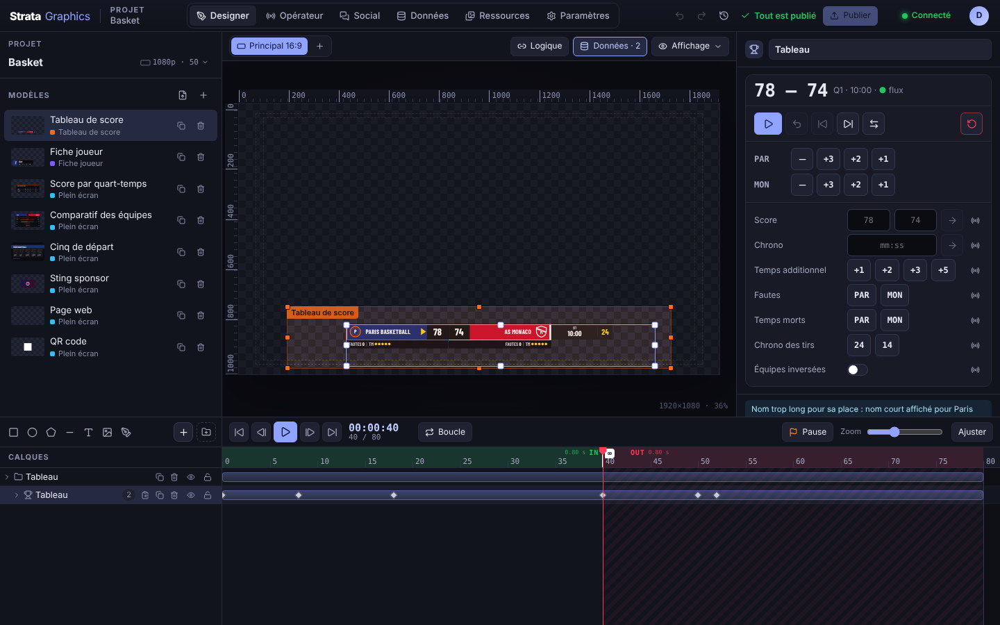

### 5.1 L'espace de travail

- **À gauche** : le bloc *Projet* (nom, format, historique des versions, publication de tout le projet) et la liste des **modèles** (vignette, zone, dupliquer, supprimer, renommer par un clic sur le nom). Sans modèle sélectionné, la scène montre toutes les zones et tous les modèles du projet.
- **Au centre** : la **scène** (règles, repères tirés depuis les règles, zones de sécurité, zones d'écran, fond studio, transparent ou noir), les boutons **Logique**, **Données** et **Affichage** de la barre d'outils, et le format édité (*Principal 16:9*, et les formats ajoutés avec *+*).
- **À droite** : l'inspecteur du modèle (durée, zone, publication) ou du calque sélectionné.
- **En bas** : la **timeline** sur toute la largeur. La colonne *Calques* liste les calques (groupes, renommer, dupliquer, masquer, verrouiller, glisser-déposer), les boutons d'insertion sont au-dessus (rectangle, ellipse, polygone, trait, texte, image, étiquette, et **+** pour les widgets).

Les panneaux se redimensionnent en tirant leurs bords (double-clic : taille par défaut). Les choix d'affichage de chaque utilisateur sont gardés sur le serveur.

### 5.2 Calques et widgets

Chaque widget est rendu à l'identique en HTML5 et par le moteur Rust, s'anime (position, opacité, cadrage…) et peut lire des données.

| Famille | Widgets |
| --- | --- |
| **Formes** | rectangle, polygone, ellipse, trait, plume (tracé libre), dégradés, contour, rayon, masque de groupe |
| **Texte** | une ligne, paragraphe, styles par mot (gras, couleur…), défilement horizontal ou vertical, comportement quand le texte est trop long (ajuster, points de suspension, couper) |
| **Image et vidéo** | image (et séquences GIF / APNG), vidéo depuis les ressources ou depuis une **entrée en direct**, animation Lottie |
| **Temps** | horloge (chiffres ou cadran, villes, langues), temps (chronomètre, compte à rebours, lancement à l'envoi, à la main ou à une heure) |
| **Données** | tableau (classements, résultats, couleurs par ligne), bandeau défilant, générique, machine à écrire, compteur animé, barre de progression, graphique (barres, lignes, aires, camembert), carte, QR code, tableau des scores |
| **Réseaux sociaux** | mur social (cartes des messages validés), badge social (plateforme ou avatar), bandeau et textes alimentés par la modération |
| **Web** | page web (URL ou HTML, relais par le serveur pour les sites qui refusent l'intégration ; sortie HTML5 seulement) |

### 5.3 Le panneau d'un widget

- **Source** (widgets qui lisent la modération des réseaux sociaux) : *Par la main* ou *Modération du projet*, avec la lecture choisie.
- **Contenu** : ce que le calque affiche. Chaque ligne a un bouton radio qui **expose** le réglage à l'opérateur : il devient une variable du modèle, remplie dans l'Opérateur.
- **Centre de contrôle** (widgets qui bougent par eux-mêmes : tableau à pages, bandeau, générique, temps, compteur, graphique, carte…), en trois lignes : l'état (page, temps, compte à rebours), les actions (lire / pause, précédent / suivant, arrêt, recharger) et les réglages (durée, enchaînement). Les mêmes commandes se retrouvent dans l'Opérateur, sur la carte du graphique à l'antenne, avec leurs raccourcis.
- **Démarrage et enchaînement** : *Dès l'In*, *Continuer (F2)* ou sur un **déclencheur** nommé ; les pages d'un tableau ou les vues d'un graphique s'enchaînent minutées, sur Continuer ou sur un déclencheur.
- **Carte, Apparence, Mouvement, Effets, Propriétés** : typographie, couleurs, ombre, flou, transformation (position, taille, échelle, ancre, rotation, opacité). Chaque propriété a son bouton d'animation.

### 5.4 Animation et timeline

- Le bouton d'animation d'une propriété l'anime ; ensuite, toute modification à la tête de lecture crée ou met à jour une **keyframe**. Les keyframes se déplacent, se multi-sélectionnent (`Maj`), et chaque segment a son **easing** (linéaire, easy ease, bézier libre, back, elastic, bounce, hold) avec l'aperçu de la courbe.
- **Marqueurs** : un marqueur **In | Out** par modèle (le take s'y arrête, l'Out repart de là) et autant de **Pause** que voulu, reprises par l'opérateur (*Continuer*), après un délai, ou sur un déclencheur. La lecture dans le Designer se comporte comme à l'antenne.
- Déplacer le libellé d'un champ change sa valeur (`Maj` ×10, `Alt` ×0,1) ; les champs acceptent des expressions (`1920/2`) ; la molette ajuste les nombres.
- Raccourcis : `Espace` lecture, `Ctrl+Z` / `Ctrl+Maj+Z`, `Ctrl+D` dupliquer, `Suppr`, flèches pour déplacer, `,` / `.` image par image, `Maj` pour bloquer un axe en déplaçant.

### 5.5 Logique

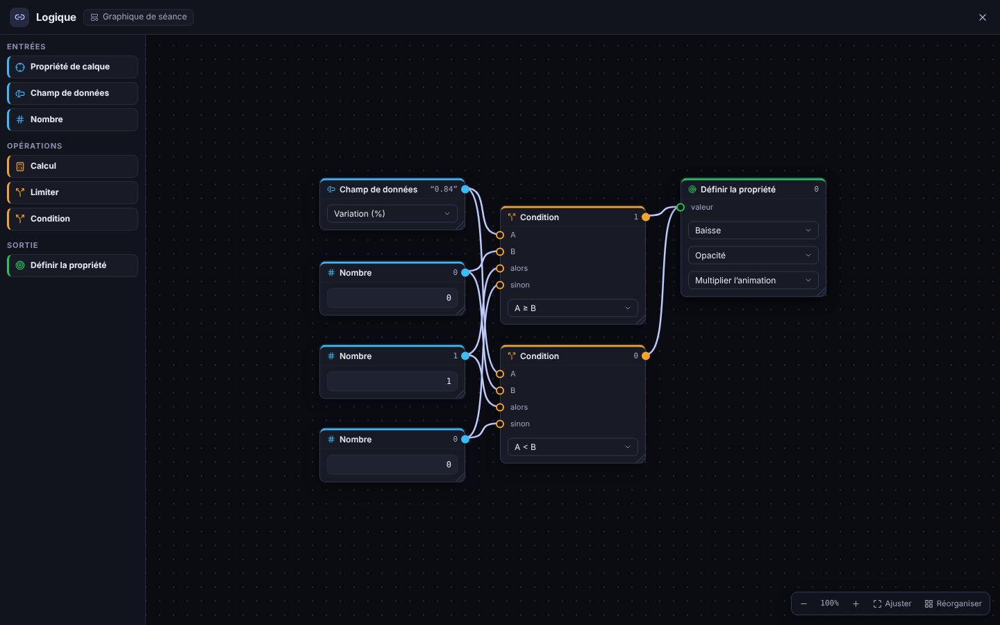

Le bouton **Logique** ouvre un canvas de nœuds reliés : des entrées (propriété d'un calque, largeur mesurée d'un texte, champ de données, nombre), des opérations (calcul, limiter, **condition**) et des sorties qui fixent, ajoutent ou multiplient une propriété. Exemple : la largeur d'une plaque qui suit la longueur du nom plus une marge, avec un minimum ; ou l'opacité d'une flèche selon le signe d'une variation. Les valeurs s'affichent en direct ; le graphe est évalué à l'identique par le rendu HTML5 et par le moteur Rust.

### 5.6 Données

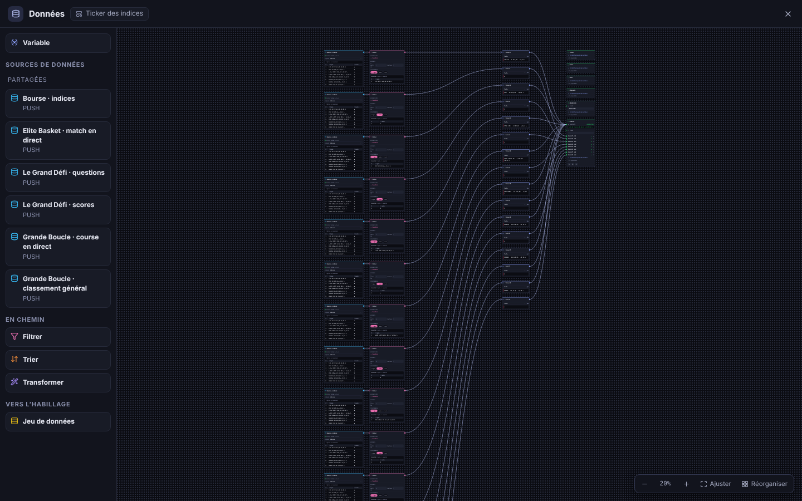

Le bouton **Données** ouvre le canvas qui relie les sources aux calques :

- **Sources** du projet et sources partagées, avec leur valeur en direct et le chemin de chaque champ.
- **Variables** : ce que l'opérateur remplit, ou ce qu'une source alimente (chemin simple comme `match.home.score`).
- **En chemin** : *Filtrer* (conditions, colonnes, lignes), *Trier*, *Transformer* (opérations sur les textes), nœuds posés librement avec leur résultat.
- **Jeu de données** : les lignes d'une liste, que le tableau, le bandeau, le générique, la courbe ou le mur social prennent par leur port *table*, et que l'opérateur fait défiler ligne par ligne.
- Chaque propriété d'un calque est un port : couleur par ligne, taille, position… Une propriété câblée est en lecture seule dans l'inspecteur, avec sa valeur.

### 5.7 Formats multiples

Un projet peut avoir plusieurs **formats** (16:9 d'antenne, 9:16 pour les réseaux…). Ajouter un format (bouton **+**) donne à chaque modèle une première mise en page : ancrages conservés, bandeaux étirés, tailles adaptées, animations gardées. On affine ensuite format par format ; les textes, les données et les nouveaux calques restent communs. Une chaîne peut avoir des **déclinaisons** dans ces formats : un seul TAKE joue partout.

### 5.8 Publication et travail à plusieurs

- Le Designer enregistre un **brouillon** en continu. **Publier** le met à l'antenne (révision v1, v2…), par modèle ou pour tout le projet, avec la liste des modèles à l'antenne à confirmer. L'historique du projet permet de revenir à une version.
- **Verrou d'édition** : un modèle ouvert par un designer est en lecture seule pour les autres, qui voient ses modifications en direct et peuvent *Reprendre la main*.
- **Import** : After Effects (Bodymovin / LottieFiles `.json`, `.zip`, `.lottie` ; `.aep` avec ses fichiers collectés ; `.mogrt`), Photoshop (`.psd`) et SVG, avec le choix des calques et l'aperçu de l'animation. Voir [`docs/AFTER_EFFECTS.md`](docs/AFTER_EFFECTS.md).

---

## 6. Opérateur

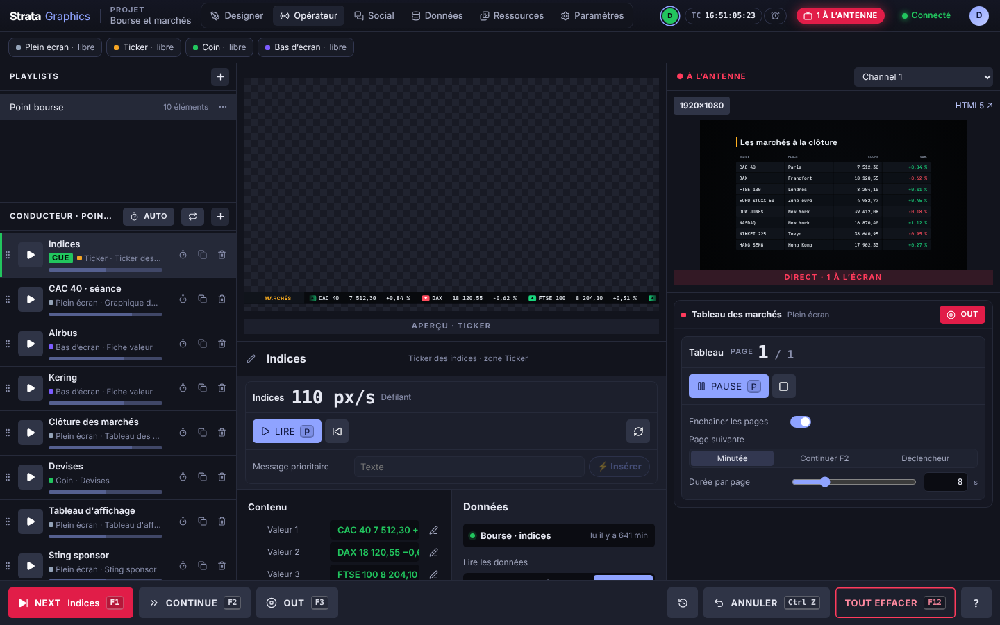

### 6.1 Quatre zones de travail

- **Playlists et conducteur** (à gauche) : les playlists du projet, les éléments du conducteur (modèle, données, zone), tally *CUE* / *À l'antenne*, mode **AUTO** (enchaînement minuté) et boucle, dupliquer, chronométrer, supprimer, glisser pour réordonner.
- **Aperçu** (au centre) : l'élément cué, dessiné comme à l'antenne, avec le centre de contrôle de ses widgets et, en dessous, son **contenu** (textes, valeurs saisies par-dessus les données) et ses **données** (source, ligne du jeu de données, lecture).
- **À l'antenne** (à droite) : la chaîne opérée, le moniteur programme (sortie HTML5 en un clic), et une **carte par graphique à l'antenne** avec OUT, ses commandes de widgets (page, lire / pause, suivant, enchaînement) et ses réglages exposés.
- **Barre du bas** : **NEXT / TAKE** (`F1`), **CONTINUE** (`F2`), **OUT** (`F3`), **ANNULER** (`Ctrl+Z`, avec l'historique des actions de la chaîne), **TOUT EFFACER** (`F12`), et `?` pour les raccourcis.

### 6.2 Zones d'écran

Chaque projet découpe l'écran en **zones** (*Bas d'écran*, *Ticker*, *Coin*, *Plein écran*…). Une zone n'affiche qu'un modèle à la fois ; prendre un modèle dans une zone occupée fait sortir le précédent (ou le remplace en mode *Cut*). Plusieurs zones sont à l'antenne en même temps, sur des couches différentes. La ligne des zones, sous le menu, montre leur occupation.

### 6.3 Chaîne et projet

Le menu de la chaîne range les sorties en *ce projet*, *libres* et *utilisées par un autre projet* ; en choisir une y charge le projet. *Aucune sortie* permet de préparer le conducteur et de voir l'aperçu sans antenne. L'Opérateur reste sur la **version publiée** : le brouillon du Designer ne le touche pas.

---

## 7. Données

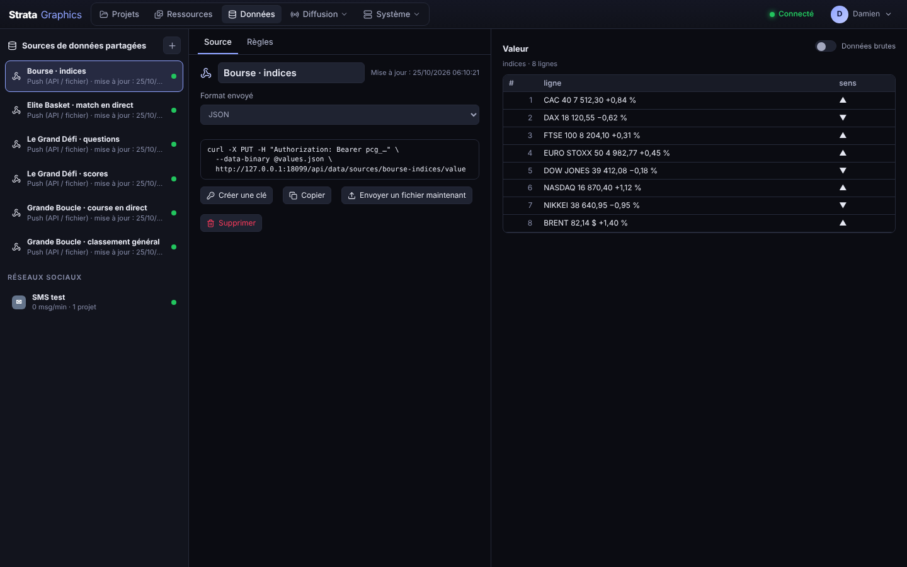

### 7.1 Sources

Les **sources partagées** (menu *Données*) servent à tous les projets ; chaque projet a aussi ses **sources propres** (page *Données* du projet).

| Type | Usage |
| --- | --- |
| **JSON API** | scores, météo, élections… en-têtes pour une clé d'API, relecture à intervalle régulier |
| **CSV / Google Sheets** | un lien de feuille partagée suffit |
| **RSS / Atom** | titres pour un bandeau |
| **XML** | flux sportifs |
| **Push** | la valeur est envoyée par `PUT /api/data/sources/{id}/value` (JSON, CSV ou XML) ou en déposant un fichier ; une clé d'API par source |
| **Modération** | créée par la page *Social* du projet : les messages validés, celui à l'antenne, le suivant, les comptes et les mots-dièse |

Chaque source est convertie en JSON et affichée en tableau ou en arbre ; un clic sur une valeur donne son chemin. Des **règles** par source corrigent les valeurs (remplacements, formats de nombre et de date).

### 7.2 Liaison aux modèles

Dans le Designer, le canvas *Données* relie une source à une variable (chemin simple) ou à un jeu de données (liste, filtres, tri). À l'antenne, le serveur remplit les champs liés et **met à jour le graphique dès que la source change**. Dans l'Opérateur, les champs liés sont en lecture seule avec leur valeur en direct, et l'opérateur peut les surcharger à la main.

Chemins : `match.home.score`, `items[0].title`, `items[-1]`, `items[*].title` (tous), `rows[{row}].name` (la ligne choisie par l'opérateur), `players[number={num}].name`, `items.length`.

---

## 8. Réseaux sociaux

Les messages des téléspectateurs (YouTube, Twitch, Facebook, Instagram, X, TikTok, WhatsApp, SMS) passent par quatre maillons, chacun à sa place :

```
 Connexion (page Données)  ──►  Modération du projet  ──►  source « Modération »  ──►  Data canvas  ──►  widgets  ──►  Opérateur
 lit la plateforme              filtre, pool, rotation      ce qui est validé             câblage           mur, carte…    TAKE / OUT
```

### 8.1 Connexions

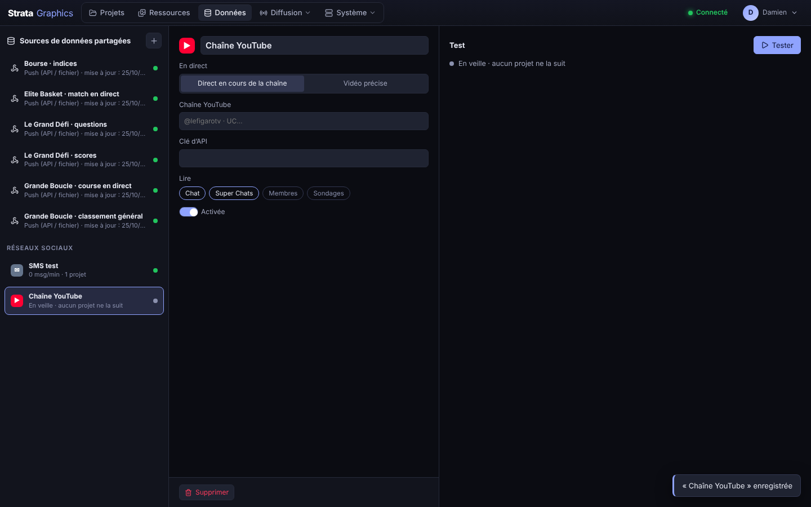

Une **connexion** est partagée par tous les projets et se crée dans *Données › +* : chaîne ou vidéo YouTube (clé Data API), chaîne Twitch (sans clé), page ou publication Facebook et compte Instagram (jeton de page Meta), recherche X (jeton Bearer), TikTok Live (script passerelle), WhatsApp (Cloud API) et SMS (Twilio), ces trois derniers par **webhook**.

- Une connexion **ne lit sa plateforme que lorsqu'un projet la suit** ; sinon elle est *en veille* et ne consomme aucun quota d'API.
- **Tester** lit une seule fois et montre l'état de la connexion et ses cinq derniers messages.

### 8.2 Le projet : Connexions et Modération

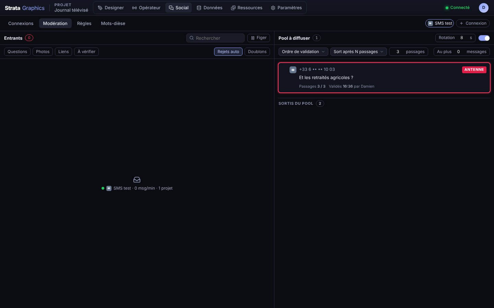

La page **Social** d'un projet a quatre onglets :

- **Connexions** : toutes les connexions partagées en cartes, un interrupteur *suivie* par carte, la création d'une connexion sans quitter le projet.
- **Modération** :
  - **Entrants** : les messages qui arrivent, analysés par les règles (toxicité, mots interdits, liens, majuscules, longueur, émojis, doublons, données personnelles, comptes de confiance ou bloqués). Filtres par connexion, par type (questions, photos, liens, à vérifier), masquage des rejets automatiques et des doublons, recherche, gel de la liste. `A` valide, `R` rejette, `E` modifie, `S` étoile, flèches pour se déplacer.
  - **Pool à diffuser** : les messages validés, dans l'ordre où ils passent. **Rotation** (une carte toutes les N secondes), **ordre** (validation, étoilés d'abord, aléatoire), **sortie du pool** (à la main, après N passages ou après N minutes), **taille maximale**. Chaque carte montre ses passages, son dernier passage, qui l'a validée ; un message sorti peut être remis. Un message peut avoir **sa propre règle** de sortie à la place de celle du pool.
  - **Le message** sélectionné : texte modifié avant antenne, nom affiché (prénom et initiale, nom complet, anonyme), règle de sortie.
- **Règles** : les filtres automatiques et leur action (rejeter, à vérifier, corriger, masquer).
- **Mots-dièse** : comptage en direct des mots-dièse suivis (total, par minute, courbe, répartition par plateforme).

La modération **ne touche jamais à l'antenne** : elle écrit dans la source **« Modération »** du projet (`onAir`, `next`, `approved`, `count`, `hashtags`). L'opérateur met la carte, le mur ou le bandeau à l'antenne comme n'importe quel habillage.

### 8.3 Les widgets

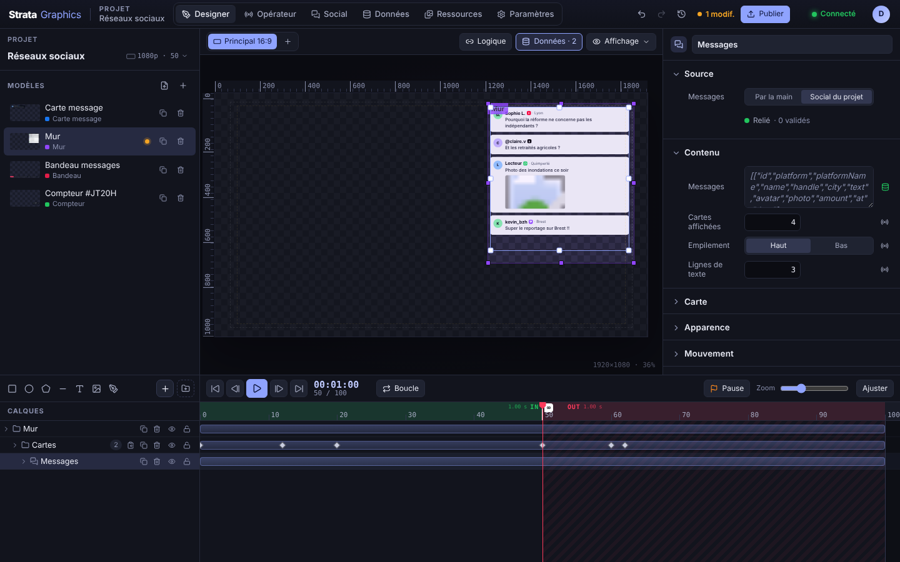

Dans le Designer, la section **Source** du mur social, du bandeau, du badge social, et aussi du texte, de l'image, du compteur et de la courbe, propose *Par la main* ou *Modération du projet* avec la lecture voulue : messages validés, message à l'antenne (nom, texte, ville, plateforme, heure, avatar, photo), nombre de validés, mot-dièse (nom, total, par minute, courbe). Un clic crée le câblage dans le canvas *Données* : le mur et le bandeau reçoivent un **jeu de données** (Modération › validés → filtre, tri → jeu de données → port *table*), les autres une variable.

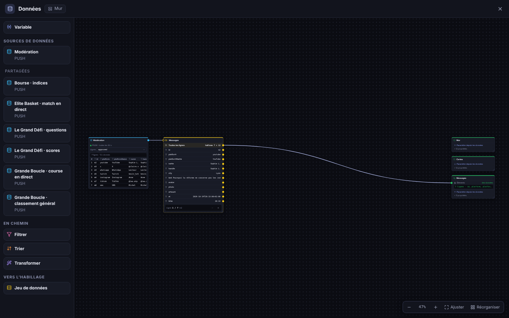

---

## 9. Diffusion

### 9.1 Flux vidéo : sorties

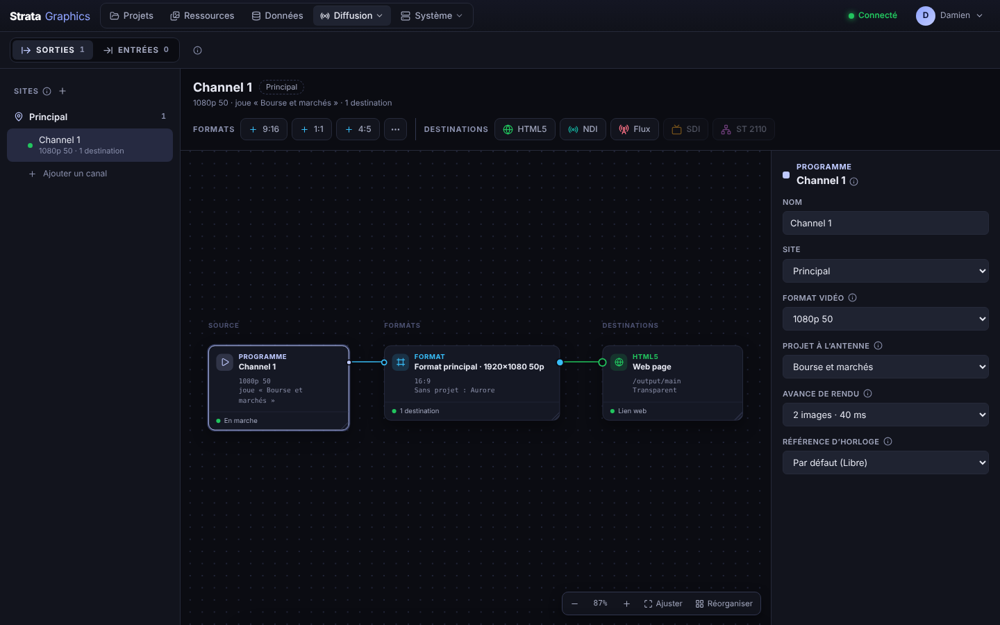

Une **chaîne** est un programme indépendant : son format vidéo, sa propre horloge de playout, ses graphiques à l'antenne. Les chaînes se rangent par **site** (studio, car, cellule web). Chaque chaîne se règle sur un canvas : *Programme* → *Formats* (l'image principale et d'autres proportions du même programme : 9:16, 1:1, 4:5…) → *Destinations*. On ajoute une destination avec les boutons du haut ou en tirant un fil depuis un format.

| Destination | Détail |
| --- | --- |
| **HTML5** | lien `/output/<chaîne>[/<format>]`, fond transparent, noir ou vert, pour OBS, vMix, un lecteur web ou un écran |
| **NDI** | nom de source, groupes, avec ou sans alpha ; runtime livré avec les installateurs |
| **Stream** | SRT (appelant ou écoute), UDP (unicast, multicast), RTMP / RTMPS, HLS servi par Strata ; H.264 ou HEVC, débit, encodage matériel, piste audio muette |
| **SDI** | carte Blackmagic DeckLink : fill + key (keyer externe), keyer interne ou fill seul ; genlock |
| **ST 2110** | fill + key (deux flux 2110-20 4:2:2 10 bits), RGBA ou YCbCrA ; multicast, TTL, SDP ; SMPTE 2022-7 sur les réseaux rouge et bleu |

Quand aucun projet n'est chargé, la chaîne envoie une **mire** (ou du transparent). Une **avance de rendu** d'une ou deux images garde une cadence régulière même quand une image est en retard ; chaque sortie envoie depuis son propre fil.

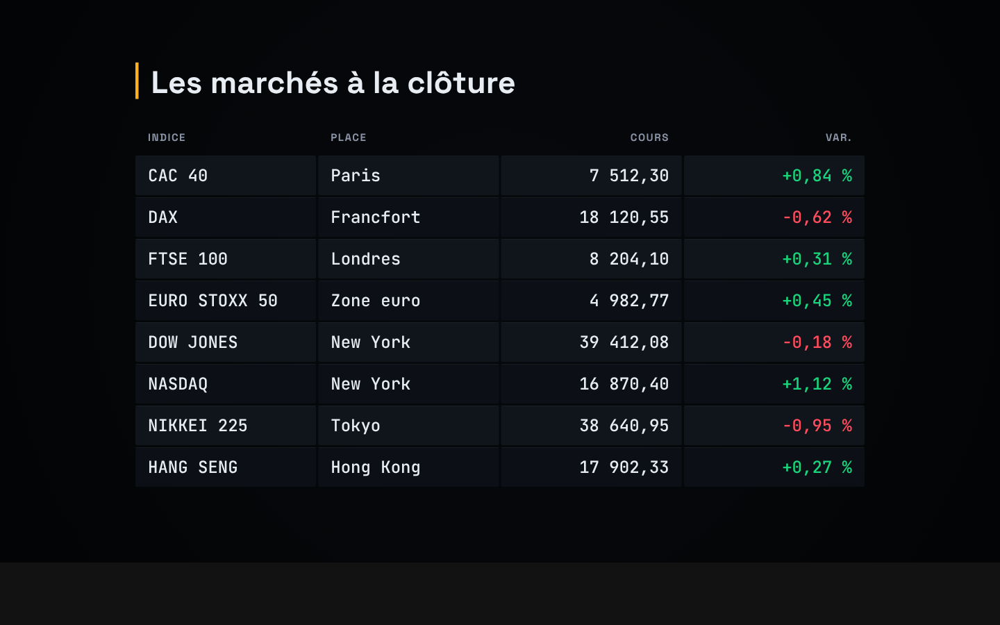

### 9.2 Flux vidéo : entrées

Les **entrées en direct** alimentent le widget *Vidéo* : SRT, UDP, RTMP, HLS, RTSP, toute URL lue par ffmpeg, **NDI** (sources découvertes sur le réseau) et **SDI** (DeckLink). Chaque entrée est décodée à la taille et à la cadence choisies, avec un tampon de lissage réglable ; la page montre une vignette, l'état, les images reçues et les pertes. Une entrée qui tombe se reconnecte seule.

### 9.3 Matériel et synchronisation

- **SDI · DeckLink** : cartes détectées, rôle de chaque connecteur (sortie fill, key, entrée, référence).
- **SMPTE ST 2110** : flux déclarés, interfaces, PTP.
- **Rôles réseau** : contrôle, NDI, média rouge, média bleu, PTP.
- **Référence d'horloge** des chaînes : libre, PTP (grille ST 2059) ou DeckLink (genlock) ; état NTP et PTP, alertes dans Performances. Mise en place : [`docs/SYNC.md`](docs/SYNC.md).

---

## 10. Système

### 10.1 Performances

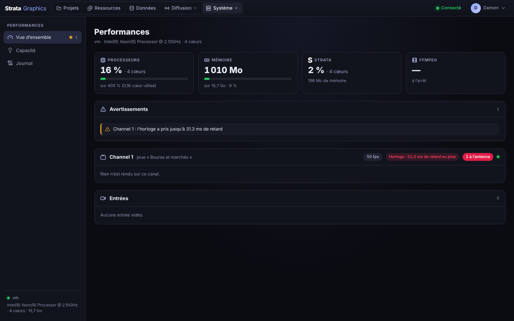

- **Vue d'ensemble** : processeurs, mémoire, part de Strata et de ffmpeg, avertissements (rendu en retard, images perdues, entrée en défaut, horloge), puis par chaîne la cadence réelle, le temps de rendu, la charge, et par sortie ou entrée les images par seconde et les pertes.
- **Capacité** : combien de rendus, de sorties et d'entrées la machine peut encore prendre, à partir de mesures faites sur ce serveur.
- **Journal** : les journaux du serveur en direct (niveau, recherche, pause, téléchargement).

La barre **CPU** à côté du nom de l'utilisateur, sur toutes les pages, résume l'occupation de la machine.

### 10.2 Journal d'antenne

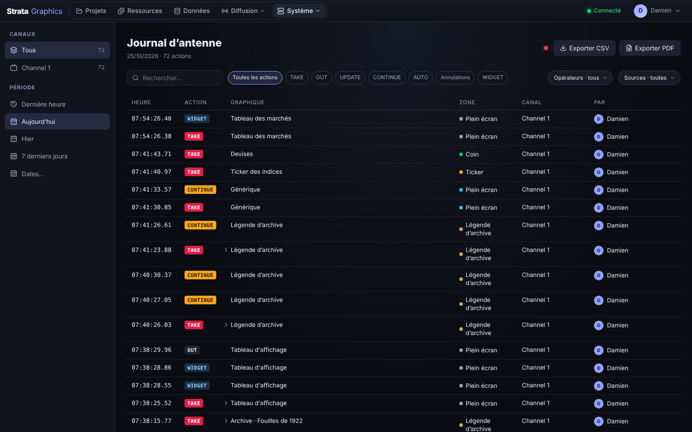

Chaque action à l'antenne est journalisée : quoi, qui, quand, sur quelle chaîne, avec quelles valeurs. Filtres par période, chaîne, action, acteur, et export CSV (`GET /api/asrun.csv`).

### 10.3 Utilisateurs

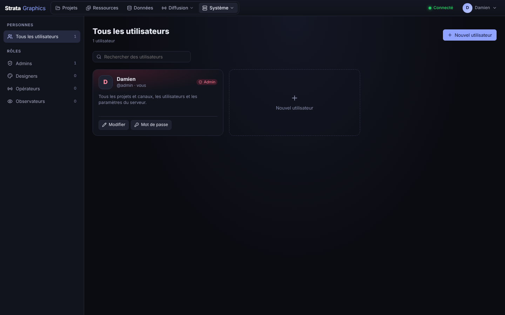

Les comptes en cartes, filtrés par rôle. Pour chaque utilisateur (hors admin), l'accès peut être limité à **certains projets** et à **certaines chaînes**. Mots de passe hachés (Argon2), session dans un cookie HttpOnly, jeton Bearer pour l'automation. Les pages `/output/<chaîne>` restent accessibles sans connexion pour les sources navigateur ; l'option se désactive dans les Paramètres.

```bash
strata-server user add <nom> [--role admin|designer|operator|viewer]
strata-server user list | passwd <nom> | delete <nom>
```

### 10.4 Paramètres

Général (nom du serveur, fuseau horaire, sorties publiques), Réseau (adresse d'écoute, rôles réseau), Mises à jour, Système (redémarrage du moteur). Tout est dans `config.json` du dossier de données ; *Appliquer* redémarre les sorties sans redémarrer le service.

---

## 11. Intégrations et API

### 11.1 Rédaction (MOS)

Strata est un **MOS device 2.8** pour Saga (Fonn Group), iNews, ENPS, Octopus… Les journalistes placent les habillages dans leurs sujets avec le plugin HTML5 `/mos/plugin` ; chaque conducteur envoyé devient une playlist du projet. Réglages et état dans *Diffusion › MOS*. Mise en service : [`docs/MOS.md`](docs/MOS.md).

### 11.2 Post-production (Adobe Premiere Pro)

Le panneau Premiere Pro liste les projets et leurs modèles, règle la durée et les valeurs exposées, rend l'habillage au format et à la cadence de la séquence en QuickTime avec alpha, et le pose à la tête de lecture. Voir [`integrations/premiere/README.md`](integrations/premiere/README.md). La même fonction est disponible pour tout outil via `POST /api/render`.

### 11.3 Surfaces de contrôle

Chemins courts sous `/api/v1/{chaîne}/…` (POST, clé d'API `Authorization: Bearer pcg_…`), pour Bitfocus Buttons / Companion, Stream Deck, pupitres :

| Action | Chemin |
| --- | --- |
| take · cue | `take/{élément}` (valeurs en JSON ou en query) · `cue/{élément}` |
| NEXT | `next` (`?playlist=`) |
| continue · out · clear | `continue/{zone}` · `out[/{zone}]` · `clear/{zone}` |
| valeurs | `update/{zone}` · `value/{zone}/{clé}` |
| undo · trigger | `undo` · `trigger/{nom}` |
| widgets · lignes | `widget/{zone}/{widget}/{start\|pause\|toggle\|reset\|…}` · `row/{zone}/{next\|prev\|n}` |

Retours : `GET /api/v1/status` et le WebSocket `/api/v1/feedback?key=…`. Sans HTTP : **OSC** sur UDP 9000 (`/strata/main/take/2`) et **texte** sur TCP 9001 (`main take 2`), activés dans *Système › API*.

### 11.4 API REST et WebSocket

La page **Système › API** documente toute l'API (OpenAPI), gère les clés et propose les actions à copier. Les routes principales :

| Méthode | Route | Rôle |
| --- | --- | --- |
| `POST` | `/api/auth/login` · `/logout` | session (cookie et jeton Bearer) |
| `GET` `POST` `PUT` `DELETE` | `/api/projects[/{id}]` · `/export` · `/import` · `/api/examples/{id}` | projets, import, export, exemples |
| `PUT` `DELETE` `POST` | `/api/projects/{id}/templates/{tid}` · `/publish` · `/draft` · `/lock` | modèles, publication, brouillon, verrou |
| `GET` | `/api/projects/{id}/templates/{tid}/thumbnail.png` | rendu serveur d'un modèle |
| `PUT` | `/api/projects/{id}/rundown` · `/zones` | conducteur, zones |
| `GET` `PUT` | `/api/data/sources[/{id}]` · `/value` · `/rules` | sources de données, valeur poussée, règles |
| `GET` `PUT` `DELETE` `POST` | `/api/social/sources[/{id}]` · `/test` · `/messages` · `/api/social/hook/{id}` | connexions aux réseaux sociaux, test, webhooks |
| `GET` `PUT` `POST` | `/api/projects/{id}/social` · `/follow` · `/rules` · `/hashtags` · `/display` · `/{action}` | modération : connexions suivies, règles, mots-dièse, pool, actions (`approve`, `reject`, `next`, `retire`, `restore`, `rule`…) |
| `GET` `PUT` `POST` | `/api/channels` · `/{id}/state` · `/{id}/project` · `/{id}/command` · `/preview.png` | chaînes, état, chargement d'un projet, commandes de playout, rendu du programme |
| `GET` | `/api/outputs/status` · `/api/channels/{id}/outputs/{oid}/fill.sdp` · `/key.sdp` | état des sorties, SDP ST 2110 |
| `GET` | `/api/asrun` · `/api/asrun.csv` | journal d'antenne |
| `GET` | `/api/system/metrics` · `/api/system/logs` · `/api/health` | supervision |
| `GET` `POST` | `/api/system/update` · `/check` · `/install` · `/upload` · `/rollback` | mises à jour |
| `GET` `PUT` `DELETE` | `/api/media[/{nom}]` · `/api/projects/{id}/media[/{nom}]` | ressources |
| `GET` `POST` `PUT` `DELETE` | `/api/users[/{id}]` · `PUT /api/me/lang` · `/api/me/display` | utilisateurs, langue et affichage de l'utilisateur |
| `WS` | `/ws` · `/ws?channel={id}` | évènements temps réel et commandes |

```bash
TOKEN=$(curl -s localhost:8080/api/auth/login -H 'content-type: application/json' \
  -d '{"username":"automation","password":"…"}' | jq -r .token)
curl -X POST localhost:8080/api/channels/main/command -H "Authorization: Bearer $TOKEN" \
  -H 'content-type: application/json' \
  -d '{"action":"take","zone":"lower-third","templateId":"lower-third","data":{"name":"Ada Lovelace"}}'
# actions : take | continue | takeOut | update | clear | trigger | widget | row — ciblées par "zone" (ou "layer")
```

---

## 12. Développement

Pré-requis : Rust stable (1.80 ou plus) et Node 22.

```bash
# 1. Web app (Designer, Opérateur, pages, sortie HTML5), embarquée ensuite dans le binaire
cd web && npm install && npm run build && cd ..

# 2. Serveur (API, WebSocket, playout, sorties)
cargo run --release -p cg-server -- --data-dir data
# → http://localhost:8080/
# → http://localhost:8080/output/main
```

En développement de l'interface, `npm run dev` dans `web/` sert l'UI sur le port 5173 et relaie l'API vers le port 8080.

### 12.1 Options du serveur

| Option | Variable | Défaut |
| --- | --- | --- |
| `--bind` | `CG_BIND` | `0.0.0.0:8080` |
| `--data-dir` | `CG_DATA_DIR` | dossier de données de l'utilisateur ; pour le service : `/var/lib/strata-graphics`, `/Library/Application Support/Strata Graphics` ou `%ProgramData%\Strata Graphics` |
| `--web-dir` | `CG_WEB_DIR` | UI embarquée (`web/dist` en développement) |
| | `FFMPEG_PATH` · `NDI_LIB_PATH` | ffmpeg et runtime NDI, si hors des emplacements livrés |

### 12.2 Configuration (`config.json`)

```json
{
  "name": "Strata",
  "bind": "0.0.0.0:8080",
  "publicOutputs": true,
  "timezone": "Europe/Paris",
  "locations": [{ "id": "studio-a", "name": "Studio A" }],
  "channels": [
    {
      "id": "news", "name": "News", "location": "studio-a",
      "width": 1920, "height": 1080, "frameRate": { "num": 50, "den": 1 },
      "projectId": "journal-20h",
      "outputs": {
        "html5": [{ "id": "html5-1", "name": "Web page", "background": "" }],
        "ndi": [{ "id": "ndi-1", "name": "STRATA NEWS", "groups": "", "alpha": true }],
        "streams": [{ "id": "stream-1", "name": "Web", "protocol": "srt", "url": "srt://0.0.0.0:9000", "listen": true, "bitrate": 8000, "codec": "h264", "background": "#000000", "audio": true }],
        "sdi": [{ "id": "sdi-1", "name": "CG1-SDI", "device": 0, "externalKey": true, "fillOnly": false, "genlock": true }],
        "st2110": [{ "id": "st2110-1", "name": "CG1", "encoding": "fillKey", "fill": "239.100.1.1:5004", "key": "239.100.1.2:5004", "interface": "10.10.0.21" }]
      },
      "renditions": [{ "id": "vertical", "name": "Vertical 9:16", "width": 1080, "height": 1920, "outputs": { "ndi": [{ "id": "ndi-2", "name": "STRATA NEWS 9:16", "groups": "", "alpha": true }] } }]
    }
  ],
  "inputs": [
    { "id": "input-1", "name": "Caméra 1", "kind": "srt", "url": "srt://0.0.0.0:10000", "listen": true, "width": 1920, "height": 1080, "fps": 25 },
    { "id": "input-2", "name": "Régie", "kind": "ndi", "ndiSource": "REGIE (Program)" }
  ]
}
```

### 12.3 Arborescence

```
crates/
  cg-core     modèle, keyframes et easing, widgets, logique, playout (sans I/O)
  cg-render   moteur de rendu logiciel (tiny-skia, texte vectoriel)
  cg-output   ST 2110-20 (RFC 4175, fill + key, SDP), SDI DeckLink, NDI, flux
  cg-server   axum : REST, WebSocket, chaînes, projets, données, réseaux sociaux, utilisateurs, UI embarquée, services OS
    examples/ les 21 projets d'exemple
    src/openapi.json
assets/fonts  polices Inter (OFL) embarquées : rendu identique sur tous les OS
packaging/    installateurs Linux, macOS, Windows ; ffmpeg ; NDI ; panneau Premiere
integrations/ panneau Adobe Premiere Pro
web/          React + TypeScript : pages, Designer, Opérateur, Social, sortie HTML5 ; i18n/ (FR / EN)
docs/         installation, architecture, After Effects, MOS, synchronisation, captures d'écran
```

### 12.4 Tests et vérifications

```bash
cargo fmt --all
cargo clippy --workspace --all-targets -- -D warnings
cargo test --workspace
cd web && npx tsc --noEmit -p . && npm run build
node web/scripts/i18n-check.mjs          # textes sans traduction française
cargo run --release -p cg-render --example bench_render       # environ 1,5 ms par image 1080p
cargo run --release -p cg-output --example bench_packetize    # environ 7 ms par image 1080p
```

---

## 13. Documentation complémentaire

| Document | Sujet |
| --- | --- |
| [`docs/INSTALL.md`](docs/INSTALL.md) | installation sur Windows, macOS et Linux, dossiers, ffmpeg, NDI, mises à jour |
| [`docs/ARCHITECTURE.md`](docs/ARCHITECTURE.md) | architecture du serveur, du moteur et de l'interface, choix techniques |
| [`docs/AFTER_EFFECTS.md`](docs/AFTER_EFFECTS.md) | import After Effects, Lottie, MOGRT |
| [`docs/MOS.md`](docs/MOS.md) | mise en service du MOS avec la rédaction |
| [`docs/SYNC.md`](docs/SYNC.md) | PTP, linuxptp, référence d'horloge, ST 2110 |
| [`integrations/premiere/README.md`](integrations/premiere/README.md) | panneau Adobe Premiere Pro |

NDI® est une marque déposée de Vizrt NDI AB. Blackmagic DeckLink et Desktop Video sont des produits de Blackmagic Design.
